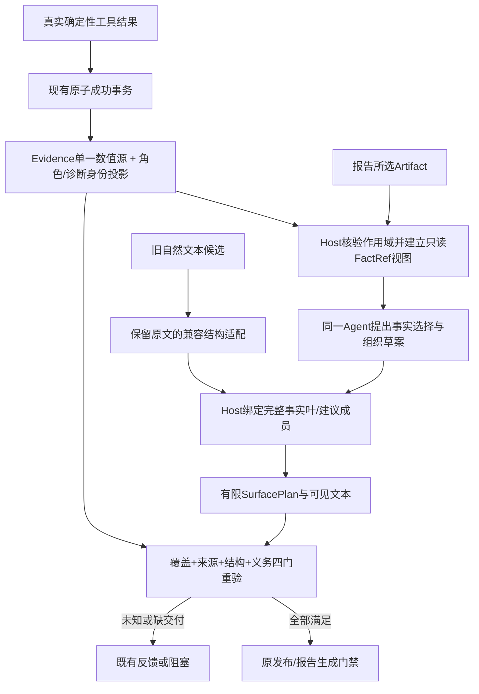

# R1 数量契约裁决与最小结构修复设计

> 所属：[六阶段总纲](./项目当前开发与交付计划_2026-10-27.md)阶段 2 的 [R1 子计划](./对话式数据Agent结构性修复实施计划_2026-10-27.md)。
>
> 当前状态（2026-10-30）：R1 核心安全与代表性主流程限定通过。产品仍 `NO_GO`。此前设计、候选和失败原样保留为历史；本轮范围与新门槛见第 8 节。

第1–6节保留设计时点，第7节收录证据索引，7.1节保留未达标实施候选；其中“本轮仅设计／未实施／待批准”均为历史状态。第8节记录2026-10-30获批的门槛与续接授权，不构成本次新操作授权；安全契约继续有效。

阅读导航：[证据索引](#7-证据索引与文档关系) → [未达标候选原记录](#r1-candidate-history-20261030) → [核心门槛修订](#8-2026-10-30-核心门槛修订与续接授权) → [最终限定验收记录](#2026-10-30-最终限定验收记录)。设计、候选和最终结果不可互相替代。

## 1. 基线、证据及本次纠正的认识

实时分支为 `handoff/manual07-wip-checkpoint-20261025`，HEAD 为 `61919340a5dd67c1c6529cd7ff2cd4fd02123547`。编辑文档前的 539 文件清单 SHA256 为 `9070c2d071c8a66336b30a6283b393e602523c16a3cfa0be8b3cf418c8436a67`，完整未提交补丁 SHA256 为 `ed143f2a1375d71024918d3e84530b0f9f81a0933c50cc9a219c9c9cbb17ff79`，均与最近两轮归档一致。原 46 个未提交文件全部保留，暂存区为空。当前文档更新不包含产品修复。

清单算法：`git ls-files` 加非忽略未跟踪常规文件，按路径排序，每行 `SHA256(文件内容)  相对路径\n`，再对 UTF-8 清单求 SHA256。文件数不是版本一致的替代证明。

最近两轮的结论必须分开保留：

| 类别 | 已有证据及本轮认识 |
|---|---|
| 已关闭的限定错误放行 | 原 R1 角色互换、中文月份漏验、缺差量/错范围/版本、聚合别名、交付来源等有冻结反例；不能外推成任意表达都安全 |
| 仍有误拒 | 真正的三项建议列表；完整正确画像中的三类质量诊断；若干既有格式与角色表达。新独立反例还发现正确 `75→38` 加“处理结果：”会误拒，互换错误仍拒绝 |
| 已撤回候选 P1 | “说明八个重复组”或“本回答按以下八个异常数据点展开”配八个标签，候选以列表长度放行。候选已撤回，不能记作当前在用修复 |
| 旧测试期待冲突 | 无正文的“三项提示”期待最终 PASS/no refs；一项正文却预告三项；未闭合代码必须拒绝，但不应强求伪造业务数值错误作为拒绝原因 |
| 本次查明的可复用来源 | 原广播画像的确定性 `quality.summary.issue_count=3` 和三个 `issue_id` 已存在。当前 value_index 保留 3，但缺少集合角色；报告又丢掉 schema/issue_id。**完整原画像不能一律降为文档计数或改成负例** |

`diagnose_data_quality` 的 issue 是规则诊断项，可能要求用户确认，**不是已核实的异常记录**。原样例三项为整行重复、指标缺失、标识非唯一；多个诊断可能涉及同一记录，同一诊断也可能涉及多条记录。诊断项数、建议条目数、实体数、重复组数均不同。

历史完整回归 `3859 passed / 12 failed / 1 strict xfail`、R1 `335/1` 是上轮执行结果，本轮未重跑完整回归。当前设计不能因此标成实现通过。

## 2. 数量契约裁决

### 2.1 用途与结果分别记录

每个数量保留原文、跨度、所属块、被计数对象及判定依据。四种用途是 **业务数量、文档结构数量、未展开提纲、unknown**；直接请求的期望产物沿用现有请求义务，不当作已交付产物。

不能把用途、证据支持、结构完整性和任务完成压成同一个 `supported`：

| 维度 | 结果 | 判定要求 |
|---|---|---|
| 数量覆盖 | covered / uncovered | 原始、标题、列表、代码/引用、修复候选中每个数量都留有去向；未发现不等于无事实 |
| 用途 | business / document / pending_outline / unknown | Host 根据对象与来源绑定确定；模型自报的 type/kind 仅是待核验提议 |
| 绑定 | supported / unsupported / unknown | 业务绑定当前数据和工具；文档绑定真实结构；未展开提纲没有“已存在成员数”证明 |
| 结构 | complete / incomplete / ambiguous | 源围栏、父子边界、成员归属及投影映射完整；报告渲染器补闭合不能改变原状态 |
| 交付义务 | fulfilled / pending / blocked | required 条件和答复自行引入的未兑现清单不能被删掉换取完成 |

最终 `completed` 必须同时满足这些维度以及原 TaskContract。内部可用 `NEEDS_ACTION` 反馈缺证或不完整；达到原轮次/预算上限后按现有状态机停止，不能发明新的无预算修复轮。本轮只定义设计，不改变状态机。

“工具本次列出3项诊断。”作为已支持的数量答复，不自动承诺逐项展开；只有“以下三项：”、明确清单请求或相应呈现节点才建立展开义务。孤立提纲的未完成结论不能扩大成“所有只回答数量的句子都未完成”。

### 2.2 判定表

| 输入/场景 | 用途与可靠来源 | 最终判定 |
|---|---|---|
| 筛选前75、筛选后38 | before/after、操作步骤、input/output、dataset/version/filter 与工具事实共同绑定 | 正确通过；75/38互换拒绝，即使两个值都在 Evidence |
| 六/七/八个月份 | 对应当前范围的 canonical group_total；中文数量不丢失 | 六支持；七/八拒绝；不能只验证其后的正确总计 |
| 三项规则诊断 | 明确 `quality_issue_count` 与当前完整诊断集合；canonical `quality.summary.issue_count` 是值源 | 支持规则列出三项，不能据此称三条已核实异常、三个重复组或三个人 |
| 完整原广播正确说明 | 三类诊断分别绑定 issue ID、字段及细节；整体诊断数绑定上述集合 | 保留原正确答案 PASS 目标；原 CAPTURE 中其他错误口径仍逐一拒绝 |
| 真实三条建议列表 | 被计数的是建议成员节点；成员是建议或已绑定事实，不是模型宣称的“八个异常对象” | 结构3与声明3一致且正文无错误时通过；无须诊断项数也为3 |
| 工具有3个诊断、回答组织成2条建议 | business issue_count=3 与 document member_count=2 分别核验 | 两个数量均可正确；不能强制一诊断一条建议 |
| “三个数据质量点”但只有标题/冒号 | 可能是提纲或未决用途，不能由同值3猜诊断角色；即使事实层有明确绑定，正文义务仍未完成 | 数量保留，最终不完成；不是静默删除“三” |
| “以下三个提示供参考”无正文 | pending_outline，0个已交付成员 | 最终 NEEDS_ACTION；流式草稿可暂不完整，但不能变历史成功答复 |
| 自称报告a25附三个提示，未提供该报告结构 | 文档声明缺少可核验对象，不由报告名/日期证明 | unknown/缺结构，最终不完成；日期仍是标识，不造测量事实 |
| 八个异常/重复组，加八个列表标签 | business/unknown，列表只证明八个文本成员 | 无业务 Evidence 继续拒绝；“提示”“供参考”“本回答”不能改用途 |
| 明确八个作者列表项，实际八项建议 | document；直接成员节点、父列表、源跨度及文本 hash | 可通过；不是把数字八列入禁止词 |
| 三个明确引用的术语标签 | 明确文字枚举的三个成员 | 可验证标签数；不证明这三个业务指标已被工具计算 |
| 2/4/6编号的三个同级成员 | 文档实际直接成员数3，编号是呈现标记 | 与报告渲染的三成员一致；不能按最大编号6计数或强求1/2/3 |
| 两个父列表项加一个嵌套子项 | 父列表直接成员数2，子节点不借给父节点 | 声明父项3拒绝；明确声明嵌套总节点数属另一个已绑定结构口径 |
| 列表后“这些点均已核实” | 新的业务确认谓词，不能继承 document proof | 没有对应确认 Evidence 则 unknown/拒绝，跨空行不豁免 |
| 模型填 `kind=document`、fake fact_id 或 supported=true | 自报元数据不赋权 | Host 重核真实来源、对象和完整正文；不因标签、ID外观或同值而通过 |

### 2.3 围栏与代码的统一完成语义

1. 保留原始 Markdown 及 source map，先识别实际围栏边界，再投影可见文本。闭合围栏内的围栏示例不是额外作者围栏；不得仅按反引号个数判断。
2. 原源围栏未闭合时标记 `structure_incomplete`。聊天流可容忍临时显示，**最终聊天与报告均不得发布为完成**，即使 Markdown 库在 EOF 自动补闭合。
3. 围栏/引用中的列表不能直接充当作者清单成员。代码里的业务数字不因在代码中而自动免验；数量仍被覆盖。
4. 对闭合且明确标为反事实/错误示例的统计文字，本最小方案不新增通用“非断言教学语义”豁免。不能可靠确定其用途时 unknown/NEEDS_ACTION，不能假称已绑定事实；该可用性限制单列，不通过放宽业务验证解决。若要支持更广泛的教学/引用表达，需要另行确定范围。
5. report 与 chat 应共享同一源结构状态。报告 HTML 的自动修正、加粗剥离或列表标记移除不产生新的成功依据。

## 3. 独立测试裁决账本

以下是**经独立裁决的建议迁移期待**，不是本轮对旧测试的实际改写。旧源码、输入、旧结果和 SHA 保留；未来实施须同时提供旧契约回放与新契约结果。安全反例不得由 FAIL 改成 PASS。完整映射见本机归档 `independent-adjudication/adjudications.json`。

| ID | 原测试/原期待 | 裁决后的期待及理由 |
|---|---|---|
| A01 | `test_r1_document_quantities[quality_note]`，PASS且无refs | 最终 NEEDS_ACTION；数量 occurrence 必须保留。明确诊断角色才可能支持业务3，不能补足空正文 |
| A02 | 同文件 `report_tips`，PASS/no refs | 缺报告成员来源，unknown/NEEDS_ACTION；不改变日期标识语义 |
| A03 | `soft_tip` / `existing_inline_tips`，PASS/no refs | 未展开提纲，最终 NEEDS_ACTION；软换行等价 |
| A04 | `quoted_three_labels`，PASS/no refs | 保留最终 PASS；改核对明确标签枚举的数量记录，不再要求所有数量审计信息为空 |
| A05 | `EXPLICIT_ANSWER` 及正确 Host 画像，PASS | **保留 PASS**。真实源有三个诊断项；不能为降低失败数改成负例；整篇其余事实继续校验 |
| A06 | `test_whole_dataset_scope_controls[hint]`，PASS | 建议 NEEDS_ACTION。独立设备夹具有5个诊断，只展开一条重复多余数4；标题3既不等于全部诊断数，也未交付3条。正文正确4仍应支持，不能借ID重复值3 |
| A07 | 独立原intro+真实三项建议及格式变体，PASS | **保留 PASS**，验证实际建议成员身份/数量，不能只修改标题使其易通过 |
| A08 | 未闭合代码：业务unsupported ref且最终拒绝 | 保留最终拒绝，细化为数量覆盖+结构不完整/用途unknown；不能要求捏造业务错误，也不能改成PASS |
| A09 | 八个异常/重复组及显式文档容器，拒绝 | 原样保留；八个标签不能证明实体数 |
| A10/A11 | 正确前后角色、中文六个月通过；互换、七/八个月拒绝 | 原样保留；新用途不能掩盖任何数量 |
| A12 | 编号2/4/6在聊天/报告一致 | 明确三个直接成员，编号不决定成员基数；必须先证明对象是文档节点 |

特别限制：A06 的设备样例与 A05 广播样例不是同一个总体，不能把“三点”标题的所有旧 PASS 批量改成拒绝，也不能全部保留。完整原未修订 CAPTURE 的其他重复口径错误仍应拒绝；一条正确声明不能批准整篇错误回答。

独立裁决者不参与产品实现。原期待→新期待、输入与来源、建议变更理由和审查意见须随未来测试改动提交；仅修改“最终False”不足以验证 unknown 或结构完成机制确实存在。

## 4. 最小方案：先绑定事实，再组织表达

### 4.1 保留什么

保留确定性计算、图表/PDF引擎、Dataset与Artifact存储、权限、MCP Gateway、预算、单一Agent循环及R1已封存操作事实。复用 `Evidence.summary.value_index`、R1 fact_projection、profile population、Claim/value_refs、现有 TaskContract 和 verification event。**没有第二个事实数据库，没有新模型服务或额外Planner。**

现有定位（本次实时源码）：

| 模块/函数 | 事实或信息边界 |
|---|---|
| `mcp_servers/excel_parser/advisor.py:217,322,348,481` | 确定性诊断、issue IDs、建议关联、显式issue_count；ID只在单个结果内有效 |
| `apps/orchestrator/agent_tools.py:1105` `_profile_with_quality` | 真实画像、角色与质量进入同一工具结果 |
| `packages/session/task_store.py:3023` `commit_tool_success` | 串行/并行、planned/ad-hoc成功事务，Invocation/result/branch/Evidence/Artifact来源 |
| `packages/orchestration/evidence_facts.py` | 操作计数投影、delta、canonical group_total，保留原校验 |
| `control/profile_claims.py:74,153` | 当前支持部分画像/重复事实，缺quality issue集合角色 |
| `control/claims.py:341,423,1176` | 先分片再局部计数；词法document_reference进identity_spans；角色/作用域绑定 |
| `agent_loop.py:2479,2599,2756,3831` | 初稿与修复重验；工具轮文本提前可见旁路；最终completed门禁 |
| `control/report_claims.py:174,267,311` | 选Artifact构造Evidence，丢质量schema/issue_id；多种文本字段分别再解析 |
| `agent_tools.py:1351` / `control/report_delivery.py:94,141` | 报告选源、生成、原文/MD/PDF hash和重核，不能只改insights |
| `apps/web/src/components/MarkdownText.tsx` | react-markdown/GFM；报告用Python Markdown，不能假定两个渲染器自动等价 |

### 4.2 数据契约与唯一来源

建议接口名仅是设计，当前尚未实现：

| 对象 | 最小字段与权威边界 |
|---|---|
| `FactRef` / `BoundFact` | source_mode、Evidence/Artifact ID、result/source hash、canonical path、dataset/root/version/scope、field、role、basis、unit、operation/step。值只读现有value_index；引用不是新事实副本 |
| `QualityIssueSet` | quality schema、来源限定的issue IDs/code/columns/action关系、canonical issue_count路径、完整性状态。引用键包括结果hash和dataset/version，不能把不同结果的quality-001当同一问题 |
| `QuantityOccurrence` | 原token/span、block、被计数对象、用途候选、绑定结果、结构/义务状态。未知量也保留；类型由Host判定，不采用模型声明作为证据 |
| `SurfacePlan` | 仅段落、标题、列表/直接成员、引用、围栏及inline包装的边界和source map；closed状态与FactRef。不是全套Markdown/自然语言语义引擎 |
| `DocumentCountProof` | 被计数结构node ID、直接成员IDs/spans、口径、原文hash、投影版本。只能支持这些文档成员，不支持业务实体 |
| `CandidateValidation` | 覆盖、业务绑定、结构完整性、义务完成四类结果及原因；完整Verifier重算/验证，不能相信传入supported |

质量投影在现有成功事务扩展 profile 分支，保留原 `operation-count-facts-v1` 行为。新质量schema区分生产规则与投影版本；身份/关系放summary元数据，数量仍只在value_index。验证显式issue_count与完整唯一成员集合一致，仅作为工具输出一致性检查；缺显式值时binder不得从长度补造业务计数。缺失、截断、重复ID、未知schema或错范围保持 unavailable/invalid，不从其他同值数字回退。

建议关系只证明某规则提出了什么建议，不证明建议已执行或问题已确认。`requires_confirmation=true`、角色置信和推荐文本中的数字不能升级为已核实业务事实或可信度统计。

报告是另一个明确来源模式：从**所选**持久Artifact构造同样的语义视图，保留schema/issue身份和关联并纳入source hash，不能伪造本run Invocation。缺来源的旧Artifact不因当前run有同值而补齐。普通建议列表可与质量诊断集合无关，列表数不由issue_count代替。

### 4.3 生成、兼容和完整验证流程



1. 工具完成后先建合法来源视图，再让同一个Agent选择事实和组织顺序。不会把标准答案、冻结oracle或测试期望送给业务模型。
2. 最小生成载体采用内部版本化 `QuantityPresentationDraft`，在现有模型响应content中解析，不要求换供应商、SDK或新增模型轮。模型提出fact_ref和组织请求，不得直接设置可信数值/角色。实现须先用离线ModelResponse验证协议；不依赖当前网关尚无的response_format能力。
3. Host解析引用为**完整事实叶**：字段、统计角色、范围、值和单位一起生成/核对。模型引用min后写max、引用旧版本、把裸数字嵌入别的谓词均拒绝。建议成员只在明确的建议行为/目标关系下建立；数字、事实修饰和“均已核实”等承接仍进入业务验证。模型自报advice或无数字正文不自动证明它是建议。
4. 结构数量由Host对实际通过绑定的成员组织后产生。标题可以自然表达，但标题里的业务数量和正文事实不被结构证明覆盖。自由标题、备注、列表项、代码和跨块承接均做残余数量及未闭合赋值槽覆盖；不能只检查带fact_ref的叶子。
5. 保留自由文本兼容入口：先保留标题/列表/围栏原结构与原跨度，再将可明确绑定的事实及建议适配为同一草案。未知用途拒绝；不能调用旧PASS兜底。旧输入原文不改写，真实三条建议、完整EXPLICIT_ANSWER和原反例都必须经过兼容入口测试。
6. 完整原三类诊断可以由已绑定的诊断细节形成对当前issue集合的引用；必须先核对对象、各细节与issue身份，再验证集合数量，不得以“碰巧3”或三个逗号倒推用途。纯建议正例则绑定实际建议节点，不借诊断数。
7. 不是事后删句或改数：每次候选保持独立原文hash和诊断；原未知量、必需条件及重复计数义务不能在重生成时无记录消失。Host渲染负责的结构计数不替换模型已提出但未获支持的业务承诺。
8. chat与report复用同一个数量契约。报告仍按其选源域重绑，title/insights/caption/interpretation/chart标题、report重验全部纳入；结构投影不能先全局去粗体再做字段标题绑定。先支持共同的有限Markdown子集，超出范围保留unknown，不升级依赖。
9. 工具轮开场白不是最终PASS，但当前已在工具执行前显示/持久化。最小治理是在既有understanding进度路径只发布已验证事实或确定的执行意图，未知数值正文留在候选审计，不成为成功历史或后续Evidence；不做前端视觉改版。工具参数与执行授权仍由原门禁决定。

### 4.3a 草案闭合接口与建议准入（独立复审要求的补充）

草案采用闭合对象，未知键一律拒绝；模型不能写入`trusted`、`supported`、`evidence`、`value`、`unit`、`role`、`dataset_version`或自签的结构proof。以下是设计schema的完整最小分支，不是可执行产品代码：

```text
Draft {schema="quantity-presentation-draft-v1", blocks:[Block]}
Block := FactChoice {kind="fact", fact_ref, display_variant}
       | AdviceChoice {kind="advice", advice_ref}
       | InspectionChoice {kind="inspection", action, target_ref}
       | ListChoice {kind="list", items:[Block], heading_style}
       | ProseChoice {kind="prose", text}
```

- `fact_ref`/`advice_ref`/`target_ref`只是模型选择，不是证明；仅可解析到本次Host构造、来源合法、当前scope的对象。`display_variant`只能选Host支持的完整事实表达/布局，不能替换字段、角色、数值、单位或自定义前后缀。列表嵌套保留父子口径；嵌套本身不增加父列表成员。
- `AdviceChoice`仅能引用真实质量producer的recommendation，引用包含源限定issue ID和action。Host核对code/columns/action关系并保留“待确认/建议”的模态；不允许模型自写“已核实/已处理”。原message里的0、条件或否定保持指令参数/建议语义，不能成为数据事实或自动执行授权。
- `InspectionChoice`只表示不执行变更的建议，初始支持`review_field_identity`、`review_unit_annotations`、`inspect_data_version`、`retain_source_reference`。目标分别解析到当前Dataset的完整字段清单、现有schema/原始列名中的单位说明、当前版本锚点、可追溯lineage root。当前ColumnProfile没有typed unit字段，此建议不依赖一个不存在的单位真相源；单位标注缺失时可建议核对，不能断言其单位已知。保留来源的建议不代表已创建备份，不调用写操作；缺root不能拿current version冒充。不存在/跨范围目标拒绝。该枚举是受限展示动作schema，不是遇到“检查/提示”等词就免验的词表，也不注册新业务工具。
- `ListChoice.heading_style`只选Host结构标题样式，不能自设数量或业务实体名称。Host按实际已核准成员生成文档数量。模型提供的自由标题必须作为`ProseChoice`另验，不能以list标签跳过其中数量。
- `ProseChoice`始终不可信。其全部数量、事实赋值槽、标题/跨块承接仍通过共享绑定；不得借相邻Fact叶改变角色或把unknown删掉。无法完整消费的文字不能作为可信叶输出。完整事实叶不支持裸值嵌入其他谓词。
- 无效JSON（包括重复键）、未知schema/key/枚举、引用失效、模糊来源、正文残余声明或结构不完整都返回原反馈/NEEDS_ACTION。模型自行写free_text、value、role、status、source或版本字段不能被忽略后接受。不得捕获错误后尝试旧宽松解析以获得PASS；不得为协议失败自动增加模型轮次。全草案同一版本，没有半段新契约、半段旧豁免。
- 不把全部闲聊改成JSON：普通无数量文字和既有纯文本通过明确的raw-text适配入口进入同一SurfacePlan及覆盖/完整性门，保留原对话功能。Host请求的草案协议或明确协议封套一旦解析失败，不能再作为raw-text尝试取得PASS。raw-text是共同契约的输入形式，不是旧验证器回退。即使表面没有数字，未闭合结构、事实赋值槽及原有必需条件也不能跳过。

### 4.3b 旧文本的受限双向语法与唯一归属

新生成路径从Host持有的节点组织文本，不需要从“点”字猜用途；旧文本适配必须用与该呈现器一致的受限语法和原文映射，不能为每个失败句子追加跳过规则。语法接口先产出候选所有者集合，**不读取数量值或比较成员数来选用途**：

1. 头部先分为明确成员引用、中性主题提纲、诊断集合、业务实体或unknown。既有数据主体、观测/确认谓词及业务实体约束全部保留；容器名“本回答”不覆盖它们。未知复合名词不能靠后缀“点”进入文档用途。
2. 中性主题来自Host已知能力/诊断元数据中的主题身份，如`data_quality`，不是任意模型标题。它须具有写作引导关系、紧邻且完整的清单，以及无数据主体/观测确认断言的头部。仅“提示/供参考”或仅一个已知主题都不够。
3. 每个建议成员必须完整适配到上一节的可信recommendation引用或受限Inspection动作及实际目标。兼容“检查字段名/核对单位/查看数据版本/保留原始版本”等表达时，核对整条祈使关系、目标和残余文字；增加“已发现八个异常”等断言立即增加业务义务，不能仍当纯建议。
4. 中性主题头且所有成员都是已核准建议，才能引用文档建议节点；诊断事实成员则必须逐项匹配IssueSet身份及细节。**“八个异常数据点”即使后接八条合法检查建议，头部仍不能变文档数量**。若头/成员冲突，或同时有两个无法消歧的合法所有者，保留unknown，不试两个数值绑定后挑PASS。
5. 合法原“三个数据质量点”+三条纯建议必须能在受限语法中得到文档成员唯一解；完整原EXPLICIT_ANSWER则应得到诊断集合解。此处是必须实现并独立验证的准入规格，不宣称现有源码已经能判定。语法级正反例未达标就停止接入，不以unknown掩盖要求保留的正例，也不扩为通用语义理解。

必须先冻结的归属对照：

| 头/正文与来源 | 唯一可接受归属 |
|---|---|
| 三个数据质量点+三个纯检查建议；工具诊断恰有5项 | document=3；不借/不要求issue_count=3 |
| 明确工具的3项诊断+分别有源的三个诊断事实 | business quality_issue_count；不当无refs的文档装饰 |
| 数据质量主题头+诊断事实/建议混合且无法确定计数对象 | unknown；重生成明确表达，不尝试同值择一 |
| 八个异常/重复组+八个标签或八条合法检查建议 | business/unknown，缺Evidence拒绝 |
| 一条合法FactRef+模型在外层写相反统计角色 | 角色冲突拒绝，不能因该FactRef值本身正确而通过 |
| 同一个issue重复建议两次 | 文档节点可为2；诊断集合仍是相应唯一issue，不增加业务诊断数 |

建议复用词法/结构基础并只保留一个数量语法入口，grammar与renderer做双向性质测试：解析生成文本可还原对象身份，格式变化不改变绑定，加入任何业务限定不会把business变document。失败输入原样保留，不能通过“换成标准标题”让旧兼容入口看似通过。

### 4.4 版本、消费者与旧路径退出

唯一版本落点选择 **TaskContract的`quantity_contract_version`**，随现有contract_json/to_dict/content_hash保存并在恢复时校验，不另存第二个可变版本开关。历史缺该字段不能假称新版通过；历史只读保留，旧活动任务如缺少安全迁移上下文则阻塞并提示重新创建受治理任务，不能静默切换解析版本或发模型请求。

实现第1步冻结唯一版本映射：`quantity-contract-v1`决定接受的`quantity-presentation-draft-v1`、`quantity-surface-v1`语法、现有`operation-count-facts-v1`及新增`profile-quality-facts-v1`来源协议、报告数量校验版本的组合。调用方/模型不得分别选择较宽松的parser或投影版本；报告新语义须使用新的校验版本标识并纳入现有validation/source/content hash，不能给旧`selected-artifact-numeric-v1`记录暗中改变含义。其他未迁移画像/统计/图表事实继续按其已有严格身份绑定，不能把缺质量投影当作整条记录无条件退回旧判定。

`AgentContext`目前不带run_id，而MCP签名上下文已有run_id。实施时从可信Host/签名上下文传入确切run_id并读取该run冻结契约，不能使用“本会话最新run”猜版本。缺确切来源时报告新版验证阻塞。这个适配只为数量契约，不能扩大为新的任务规划或前端状态工程。

| 必迁移入口 | 新路径及退出要求 |
|---|---|
| 串行/并行、planned/ad-hoc成功 | 同一TaskStore事务封存；不得在Agent自行复制数值或封存调用方索引 |
| 最终初稿、反馈重试、确定性repair | 同一候选协议与四门校验；原始输入和未解决义务可追踪 |
| 工具轮开场白、最终消息发布 | 不把未验证文字变已验证事实；最终仍必须通过完整Verifier |
| chat/profile/table/quoted统计 | 共享结构及原文映射，复用已有角色/范围/单位绑定；不新增词语豁免 |
| report各文本字段、本地/MCP report-tools | 同一选源模式和契约版本；确定性MD/PDF核心不反向依赖自然语言解析 |
| report_delivery、Claim持久化、重开 | 重核source/content/PDF hash、契约版本和绑定；不相信旧validation.status或模型proof |

新版中退出 `_quantity_context` 的document_nouns直接免验和`identity_spans`无结构删除路径。原路径可仅用于shadow差异诊断或历史读取，不得形成“旧PASS OR 新PASS”。并行发布前，迁移清单每个消费者都须有正反例；未覆盖就不切换。

## 5. 实施范围、顺序和验收门槛

下列是**同一个R1补齐工作的内部步骤**，不是启动R2–R4/V1或五批新部署；本轮没有实施。

| 顺序 | 模块范围和接口变化 | 免费关闭门槛 |
|---|---|---|
| 1 | 冻结本裁决，TaskContract版本/恢复；测试裁决文件与旧结果并存 | 旧→新期待逐条审查；产品既有安全反例不改为通过；unknown版本阻塞 |
| 2 | `profile_claims`/共享事实投影、TaskStore成功事务、report选源投影；质量集合/FactRef | 3项诊断/5项设备诊断/2条建议分开；错ID、错源、错版本/范围、缺schema/count、同值借用拒绝；原R1投影不倒退 |
| 3 | `claim_structure`/`statistic_statements`与共享数量适配；原文映射和用途/结构结果 | 真实三建议通过，2/4成员拒绝；单独提纲未完成；八业务对象配八标签拒绝；围栏/格式等价；N17前后角色正确前缀不误拒 |
| 4 | `agent_loop`初稿/repair/开场白、AgentContext、report消费者；有限组织草案 | FactRef角色调换、model自报类型、裸值装饰、正文附加数量、跨段确认均不能绕过；不增加隐式模型轮 |
| 5 | 同一最终版本独立复审、专项/相邻/完整免费回归及静态检查 | 第8节核心门槛及延期登记齐备才可限定通过；既有strict xfail按实际状态单列，不新增xfail；其余失败保留、不冒充全绿 |

不改确定性计算/图表/PDF内核，不新建事实表，不升级依赖，不引入通用文本语义系统，不修R2计划/澄清或R4视觉交互。真实同会话主链仍需后续另行批准；免费回放不等于真实Agent。

回滚按本批增量回滚候选协议/结构适配，停止新版run准入；保留原/新Evidence、Claims、文本、版本和诊断，不回滚业务数据或账本。旧代码不懂新版本时只读/阻塞，不能恢复同值兜底或已知数量遗漏。原R1成功投影与预算保守规则保持；恢复时禁止自动重发请求。

### 必须保留的验收维度

- 正确75/38、中文六个月通过；互换、七/八个月数量保留并拒绝。新发现的“处理结果：”前缀误拒不能靠改期待退出。
- 不同值、字段、单位、分母、dataset/root/version/filter、step/before/after/removed、重复excess/participants/groups均不能串用。
- 诊断集合的issue_count不是确认异常实体数；建议数量也不是诊断数。去除或伪造质量身份后，即使数字仍为3也不能支持业务诊断数。
- 每个原始数量/赋值槽可追踪，source map可逆定位；不以no refs替代用途证明。完整Verifier收到伪造claims/proof、旧text hash仍重新拒绝。
- Chat/report同输入用途、数值和完成状态相同；记录来源域差异，不用缺Artifact的脚本分支冒充报告通过。代码自动闭合及加粗清洗不能改变结果。
- 最终发布、工具轮、repair、报告各文本字段和重验共同受约束；持久化及恢复不能重新赋予旧未验证文字权威。
- usage缺失继续保守记账；预算仅隔离测试，真实账本不可故障注入。真实模型、图表/PDF、CI、Docker/MCP HTTP、目标机器各自保留未验收状态。

## 6. 本轮诊断、独立复审与实施条件

本轮新独立诊断先冻结30个手工oracle场景，再对当前源码执行87个消费者检查：67 PASS、17 FAIL、3待裁决观察；另3个report分支无相应Artifact而NOT_RUN。30/30数量候选保留，不能据此宣称绑定已正确。17失败是5种明确文档列表正例×3路径，以及N17正确前后数量加前缀的两条路径。业务八项、错单位/月份、互换、自报document和伪造supported Claim均拒绝。

闭合错误示例的3个观察保留原记录，本设计按第2.3节裁为当前最小范围内unknown/不授予PASS；这是新契约裁决，不将当前拒绝冒称已实现原因。当前没有四维结果接口，因此“布尔拒绝”不能验证结构不完整或提纲义务机制已落地。

另有12例旧案例实际观察、设备5项诊断独立复算及质量绑定5例probe，见证据索引；数目与上面矩阵可能重叠，不相加作产品覆盖率。本轮不重复完整回归，产品与既有测试未变，历史3859/12/1仍是历史。

本文件已完成独立设计复审。首次提出的建议身份准入、闭合协议和事实句/展开义务区分等问题已补入4.3a/4.3b；终审结论为**设计具备申请实施条件**，不是R1实现通过。精确受审文件hash、问题闭环及26项新增人工设计反例在本轮归档`design-review/`中；这26项尚未执行，不计入上述87项实测。实施后的语法、完整Verifier、生成及报告路径仍必须逐项达到门槛，不保证任意自然表达已支持。

仍需用户决定的是**是否批准按此最小边界实施，以及是否在未来实施中按A01–A12迁移明确错误的旧期待**。本轮已经给出裁决和理由，未实际改旧测试。若用户要求同时保留“孤立清单最终PASS/no refs”及“必须有实际成员/unknown保留”，两者不能同时满足，实施应继续阻塞。更广泛的反事实代码教学/自由复合语义不属于本方案，需另行决定是否扩范围；默认不扩大。

## 7. 证据索引与文档关系

以下绝对路径为本机归档，不是同事阅读核心契约的前置依赖：

- `2026-10-23/task/r1-structural-fix-20261027T192805Z/`：首轮R1完整报告、全量回归、原独立复审、完整工作树与冻结82项。
- `2026-10-23/task/r1-quantity-closeout-20261027T234346Z/`：第二轮报告、`withdrawn-candidate/incremental.patch`、独立P1反例、恢复核对和最终12失败。
- 本轮：`/mnt/c/Users/33549/Documents/Codex/2026-10-23/task/r1-quantity-contract-design-20261029T034904Z/`，工作副本位于同名`/tmp/`目录。
- `baseline.json`、`baseline.patch`、`baseline-manifest.sha256`：文档编辑前实际基线；`final-audit.json`：本轮仅文档变化及产品/测试/预算不变核对。
- `independent-adjudication/`：独立A01–A12裁决、旧案例观察、设备质量复算；`source-review/`：实际路径和质量来源缺口；`new-independent-diagnostics/`：先冻结oracle的新组合反例和当前结果。
- `design-review/`：最终设计独立复审及修改闭环；`commands-and-results.txt`、`ARCHIVE-SHA256SUMS`：命令、结果与归档校验。

历史授权与结果保留原日期。[R1原设计](./R1_事实角色与数量覆盖设计决定_2026-10-27.md)的删除差量/封存角色设计继续有效；其中尚未裁定的文档数量分类及“所有旧期待不可审理”由本文件的独立裁决接管，未实施前不改产品现状。总计划的六阶段和R2–R4/V1顺序、其他业务/前端/部署/目标机门槛不变。


<a id="7-2026-10-30-实施候选记录门槛未关闭"></a>
<a id="r1-candidate-history-20261030"></a>

### 7.1 2026-10-30 实施候选记录（门槛未关闭）

用户本次已批准按本设计实施 R1，以及严格按 A01–A12 迁移旧期待。本文前述“仅设计、未授权实施”是设计建立时的历史状态。本次授权不包含 R2–R4/V1、真实模型、推送或部署。当前 HEAD 仍为 `61919340a5dd67c1c6529cd7ff2cd4fd02123547`；全部既有 R1 修改保留，修复检查点尚未提交。

候选沿现有 Evidence 扩展质量诊断身份投影；值继续引用 value_index。新增闭合草稿和受限表面结构，文档成员证明与业务事实分开，按原文位置合流用途、绑定及交付义务；聊天、报告原文与草稿统一准入。报告要求精确 TaskRun，旧活动任务契约缺失或未知时在模型调用前阻塞。工具轮前言只发布 Host 已知执行意图，模型原文保留在审计。

迁移旧期待仅有五个测试文件、十个裁决条目：A01×1、A02×2、A03×5、A04×1、A06×1。其中九个未交付提纲/缺来源案例改为 NEEDS_ACTION，A04 保留 PASS 并要求结构证明。A05/A07 的正确画像、A09 的业务安全负例及 A10/A11 的角色/月数期待未改；没有新增 xfail。另两处旧 Host fixture 仅补传已经实际创建的 run_id，原事实与断言不变。每条原输入、旧/新期待、依据及 before 快照保存在本轮迁移账本。

候选仍为 **BLOCKED / NO_GO**，不得用专项通过替代门槛：

最终候选完整免费回归为 **3672 passed / 328 failed**，本轮没有计入通过的 xfail。独立核查确认多行括号中的未知统计值 `b17` 存在错误放行；真实 Host 也有正确回答误拒。该 P1 与其余失败均保留原始证据并停止本轮实现，不生成修复提交。不能把大量失败一概归为后续批次；详细逐项分类及修前对照以本轮最终报告为准。

- 独立正例“这里是两个标签：‘甲’‘乙’，另一名称是‘旁注’。”仍有数量误提取风险（实际冻结输入使用中文双引号）；不能用忽略“另+一”来换取通过，因为剩余实体数量可能被吞掉。
- `字段 | 最小值 | 最大值` 的画像表格仍有正确事实误拒。独立精确修前副本亦复现；原文位置映射正确不等于业务角色绑定通过。
- 旧测试要求宿主在模型连续答错后删除错误数量、改用工具结果并 completed，与本设计不删未知义务的要求冲突；该期待不在 A01–A12，保留失败，不能擅自迁移。
- 完整免费回归及其他接口迁移问题必须逐项列出；既有 strict xfail 不计通过，若其精确匹配因新审计字段而不再触发，实际失败照实报告。

本次独立诊断原文、原/新测试、候选撤回对照、最终源清单及完整测试命令在本机归档 `2026-10-23/task/r1-quantity-implementation-20261030T015653Z/`。该路径是本地证据位置，不是运行时依赖。最终计数、指纹和未关闭清单以同目录 `final-report.txt` 为准。不存在产品交接 GO，也未批准后续批次。

## 8. 2026-10-30 核心门槛修订与续接授权

变更依据：用户明确批准优先关闭核心错误放行与代表性主流程阻断，不再要求所有历史格式/夹具/文案测试变绿。前轮完整回归 3672 PASS / 328 FAIL 仅为修前证据，不能改写成新结果。新批次保留全部原修改及失败证据，起点精确匹配归档 `r1-quantity-implementation-20261030T015653Z` 的547文件指纹。

### 限定通过的必要条件

1. **共同完成门**：真实数量审计的 blocked/pending/uncovered/结构未闭合必须阻断聊天、报告、修复候选及完整 Verifier，不能以 claims=[] 视为成功；无效协议不能回退旧路径。
2. **核心安全**：原 b17 单行/多行、未知数量、75/38 前后互换、dataset/root/version/filter/field错配、中文月份七/八、无据删除数/重复组/实体数、列表证明冒充业务证明必须拒绝；正确对应事实通过。普通指代不是量化业务声明，不能靠关键词豁免真正数量。
3. **代表性主流程**：真实合成上传、画像/质量生产者、TaskStore/SQLite Evidence、筛选前后解释、所选分析报告生成/读取必须验证正反例。允许离线脚本模型提供冻结候选，但不能 mock 掉工具、数据与事务来代替该层证据；不宣称真实 Agent 或完整业务验收通过。
4. **覆盖有效性**：旧夹具如果在 source/run 门前失败，不能据此声称其原安全断言通过。必须补足同机制真实来源的核心反例；仍未知且可能影响核心的失败继续阻塞。
5. **收尾**：最终专项、完整免费回归、静态检查及独立代码复审对应同一代码指纹；每个剩余失败有分类/影响/证据/后续归属/验收条件。核心错误放行、主流程阻断、妨碍核心验证的问题不能延期。没有批量改安全期待、新增 xfail、删失败证据或改预算。

### 失败分层与延期规则

| 类别 | R1 门槛 | 延期前需要的证据 |
|---|---|---|
| 核心错误放行 | 阻塞 | 必须关闭，原/新增安全反例重验 |
| 代表性主流程阻断 | 阻塞 | 真实工具与数据库正例通过，负例仍拒绝 |
| 非关键误拒 | 可登记延期 | 明确支持边界、实际拒绝、非主流程、后续批次与关闭条件 |
| 夹具／契约迁移 | 条件延期 | 原断言未触达需标明，等价核心真实来源验证已补足；不得隐藏安全未知 |
| 文案／断言差异 | 可登记延期 | 实际安全结果正确且已核实，不把错误拒绝当作安全通过 |
| 未查明、可能核心正确性 | 阻塞 | 先定位；不能默认归入低风险 |

本轮 R1 限定通过后单独提交，再按既有 R2 子计划固定范围并实施，不再等待第二次批准。R2 使用同一原则，但不得把 R1 非相关格式遗留吸入范围。两批完成后停止；R3/R4/V1、真实模型、预算写入、推送/合并/部署均不在授权内。限定通过不代替阶段2真实主链、阶段5最终验收或阶段6目标机器交接。

## 2026-10-30 最终限定验收记录

[R1 限定检查点与延期登记](./R1_限定检查点与延期登记_2026-10-30.md)记录最终代码、完整回归、独立复审、已修核心缺陷与所有延期类别。真实数量审计仍阻断unknown；内部审计发现与业务重复修复义务分开，不能伪造第三个业务数量。限定通过不是全测试全绿、阶段2真实链通过或交接GO。后续仅按已批准R2范围继续。
